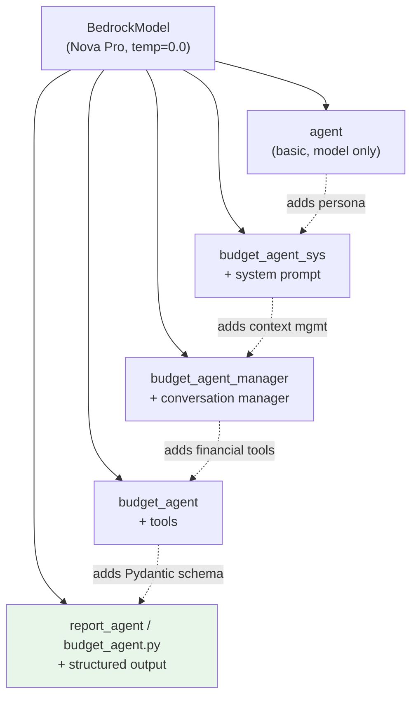
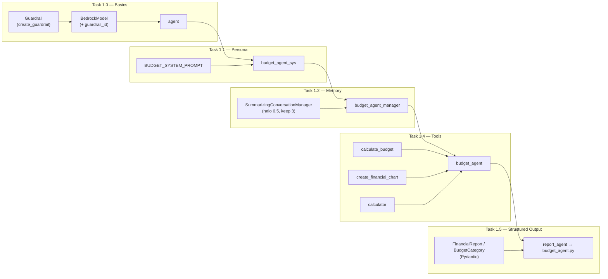
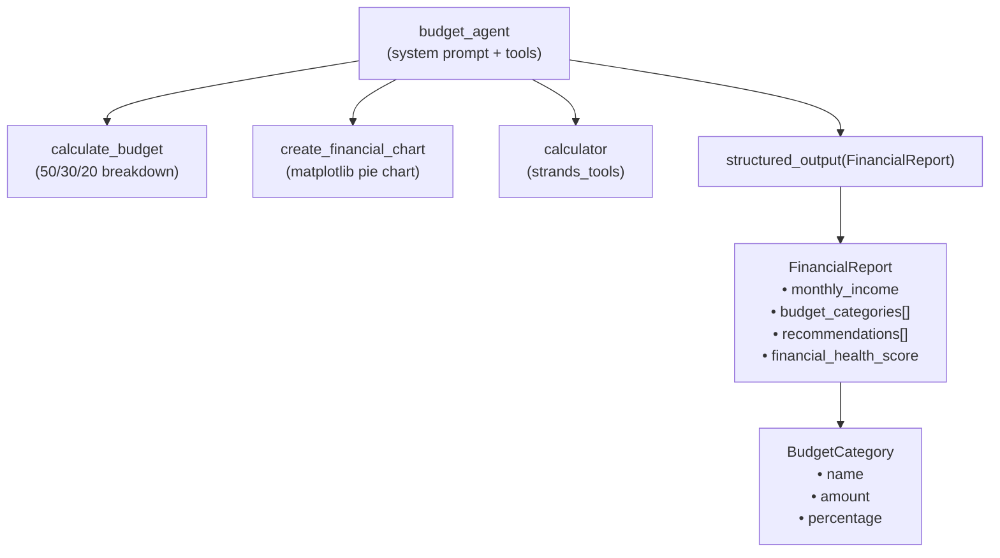
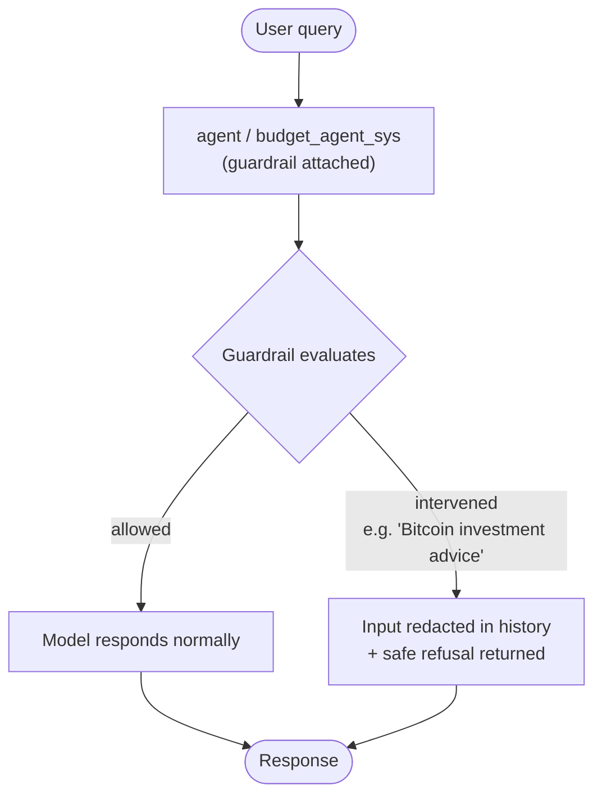
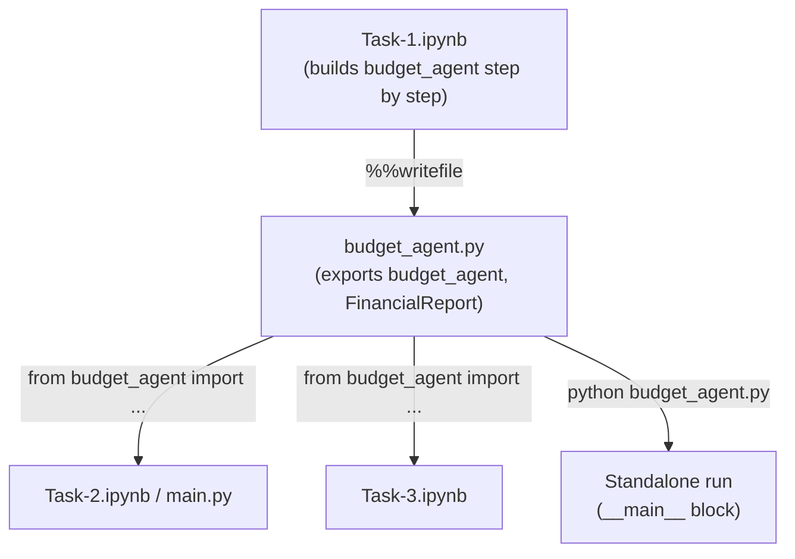

# Task 1: Build a Personal Budget Assistant with Strands

This document explains how the agents built in `Task-1.ipynb` relate to each other,
using Mermaid diagrams.

Unlike Task 2 (which coordinates multiple agents at runtime), Task 1 is a **progressive
build-up of a single agent**. Each step starts from the same `BedrockModel` and adds
one capability — a system prompt, then conversation management, then tools, then
structured output — until it reaches the final `budget_agent` that is exported to
`budget_agent.py` for Tasks 2 and 3 to import.

So the "relationship" here is not a call graph between peers; it is a chain of
increasingly capable agent configurations that all share the same underlying model.

## 1. Progressive Agent Build-Up

Each agent in the notebook is a new `Agent(...)` configuration layering one more
feature on top of the previous idea. They are separate variables, not callers of one
another.

The dashed arrows show *conceptual progression* (each step inherits the ideas of the
previous one), not function calls.

## 2. Feature Layering

Each capability added across the tasks, and which agent variable introduces it.

## 3. The Final Budget Agent and Its Tools

The complete `budget_agent` (the one exported to `budget_agent.py`) wraps the Bedrock
model with a system prompt and three tools. Note it does **not** attach the guardrail —
the structured-output call uses a forced tool call that a guardrail intervention would
break, so the exported agent omits it.

## 4. Guardrail Interaction

The guardrail (`guardrail-no-bitcoin-advice`) is attached to the model used by the
early agents. When it intervenes, the Strands SDK redacts the offending message in the
conversation history so follow-up questions aren't also blocked.

The notebook demonstrates this directly: `agent("Bitcoin investment advice")` is
blocked, and `pretty_print_messages` then shows the user turn stored as
`[User input redacted.]`.

## 5. Export and Reuse

The final cell uses `%%writefile budget_agent.py` to serialize the finished agent to a
standalone module. This is why `budget_agent.py` appears inside a code cell: the cell
isn't executed as Python, it writes its body to disk so later notebooks can import it.

## Summary

| Step | Agent variable | Capability added | Key objects |
|------|----------------|------------------|-------------|
| 1.0 | `agent` | Basic model + guardrail | `BedrockModel`, `create_guardrail` |
| 1.1 | `budget_agent_sys` | System prompt (persona) | `BUDGET_SYSTEM_PROMPT` |
| 1.2 | `budget_agent_manager` | Conversation memory | `SummarizingConversationManager` |
| 1.3 | *(same agent)* | Streaming responses | `stream_async` |
| 1.4 | `budget_agent` | Financial tools | `calculate_budget`, `create_financial_chart`, `calculator` |
| 1.5 | `report_agent` → `budget_agent.py` | Structured output | `FinancialReport`, `BudgetCategory` |

The defining pattern is **incremental enhancement of one agent**: each task keeps the
same Bedrock model and adds a single new capability, culminating in a reusable,
tool-equipped, structured-output budget agent that becomes the foundation for the
multi-agent system in Task 2.
