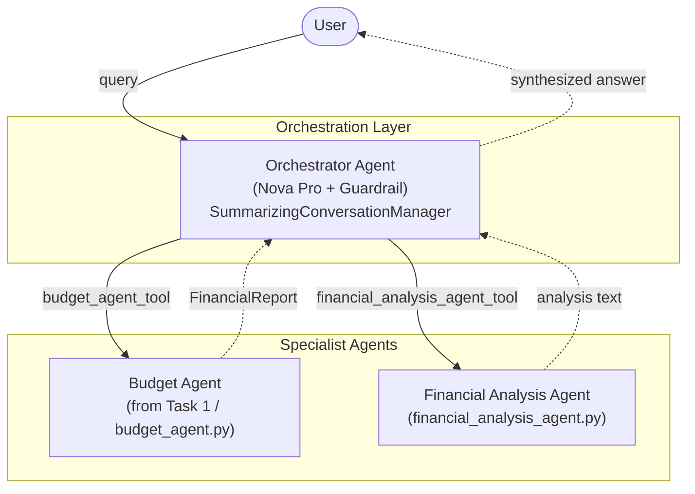
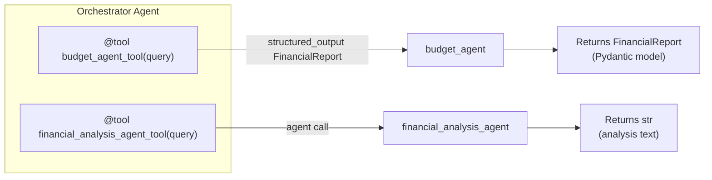
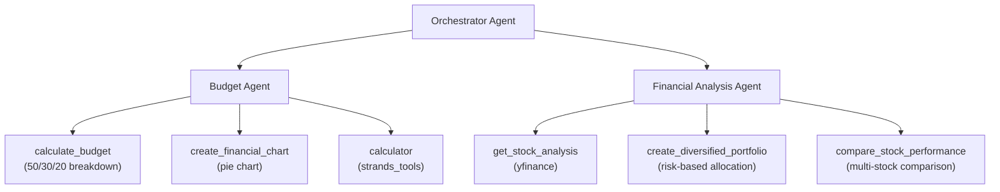
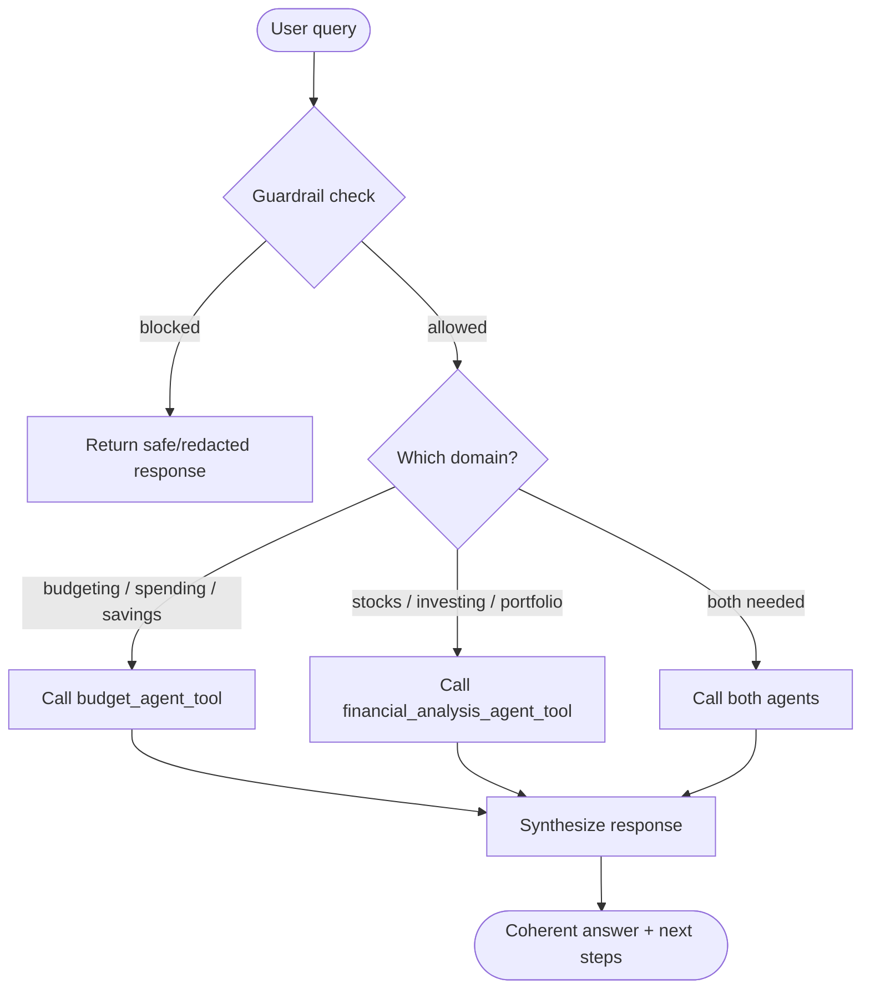
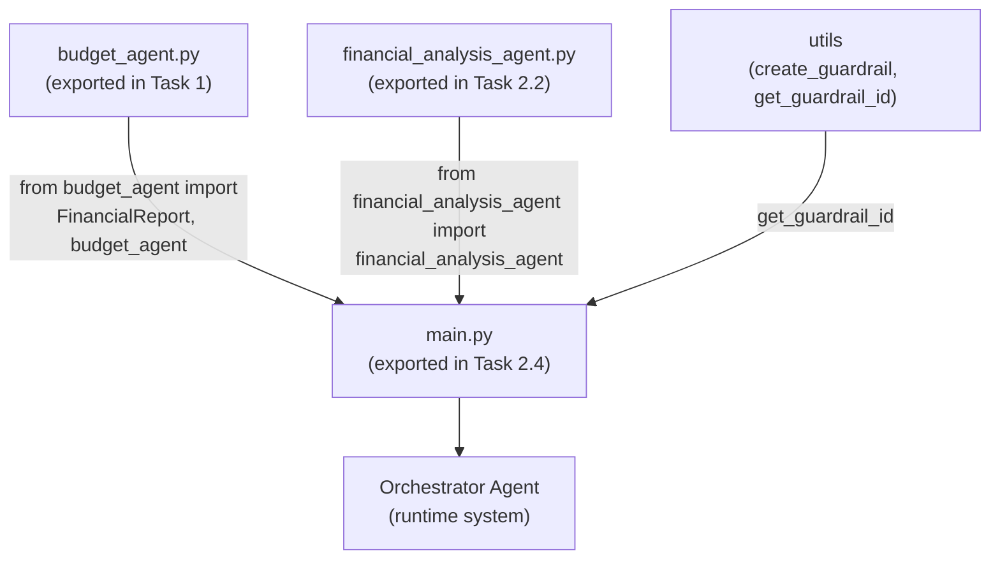

# Task 2: Multi-Agent Workflows with Strands

This document explains how the agents built in `Task-2.ipynb` relate to each other,
using Mermaid diagrams.

Task 2 moves from a single agent to a **hierarchical multi-agent system** built with
the Strands ["Agents as Tools"](https://strandsagents.com/latest/documentation/docs/user-guide/concepts/multi-agent/agents-as-tools/)
pattern: specialized agents are wrapped as `@tool` functions and handed to a top-level
**Orchestrator Agent** that routes requests and synthesizes answers.

## 1. High-Level Architecture

The Orchestrator sits on top and delegates to two specialist agents. Each specialist
owns its own domain tools. The user only ever talks to the Orchestrator.

## 2. "Agents as Tools" Wrapping

The key mechanism: each specialist agent is wrapped inside an `@tool`-decorated
function. From the Orchestrator's perspective these are just tools it can call — but
each tool call actually invokes a full downstream agent.

Note the difference in return contracts:

- `budget_agent_tool` calls `budget_agent.structured_output(...)` and returns a typed
  `FinancialReport` Pydantic object (income, budget categories, recommendations,
  health score). On error it returns a default `FinancialReport`.
- `financial_analysis_agent_tool` calls the agent directly and returns a plain string.
  On error it returns an error string.

## 3. Tools Owned by Each Agent

Each specialist agent carries its own set of domain tools. The Orchestrator does not
call these leaf tools directly — it calls the specialist, which then uses its tools.

## 4. Request Routing Flow

How a single user query flows through the system. The Orchestrator decides which
specialist(s) to consult, may call one or both, then combines the results.

Example of a combined query from the notebook:
*"Compare Tesla and Apple stocks, and tell me if I can afford to invest $2000 with my
$4000 monthly income."* — this triggers **both** the Financial Analysis Agent (stock
comparison) and the Budget Agent (affordability against income), with the Orchestrator
merging the two into one answer.

## 5. Module / Import Relationships

The notebook builds each agent and exports it with `%%writefile` so later stages can
import it. This is how the pieces connect across files.

- `budget_agent.py` (produced at the end of Task 1) exports `budget_agent` and the
  `FinancialReport` schema.
- `financial_analysis_agent.py` (produced in Task 2.2) exports
  `financial_analysis_agent`.
- `main.py` (produced in Task 2.4) imports both, wraps each as a tool, attaches a
  Bedrock guardrail via `get_guardrail_id()`, and assembles the Orchestrator.

## Summary

| Layer | Component | Role | Returns |
|-------|-----------|------|---------|
| Top | Orchestrator Agent | Routes queries, coordinates specialists, synthesizes answers, applies guardrail + conversation memory | Combined natural-language answer |
| Specialist | Budget Agent | Budgeting, spending analysis, savings | `FinancialReport` (structured) |
| Specialist | Financial Analysis Agent | Stock analysis, portfolios, comparisons | Analysis text |
| Leaf tools | `calculate_budget`, `create_financial_chart`, `calculator`, `get_stock_analysis`, `create_diversified_portfolio`, `compare_stock_performance` | Domain-specific computation | Strings / charts |

The defining pattern is **hierarchy through tool-wrapping**: specialist agents are
exposed to the Orchestrator as callable tools, letting a single coordinating agent
compose multiple domains of expertise into one coherent response.
