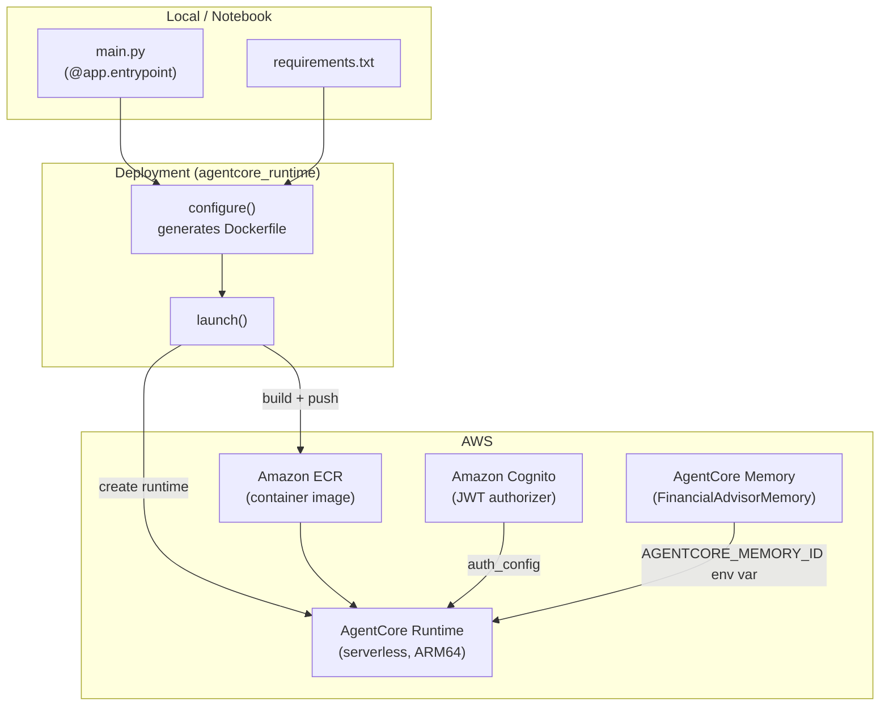
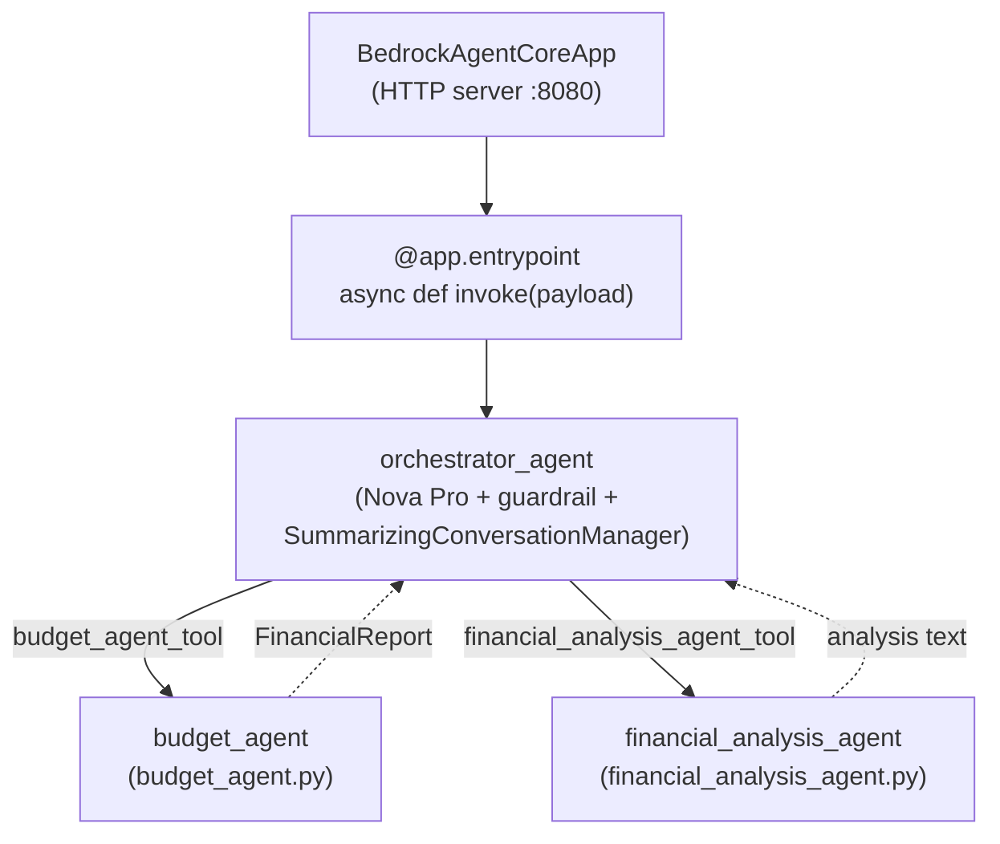
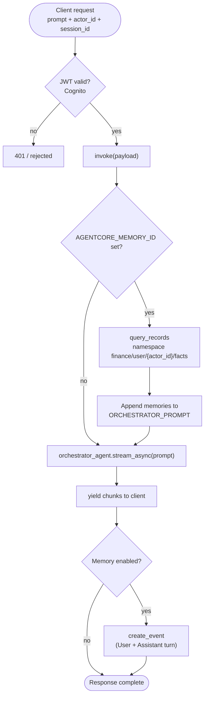
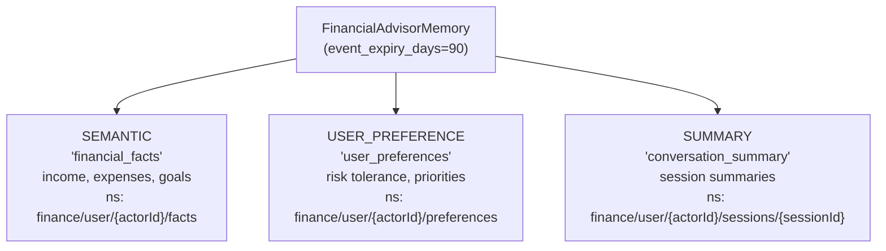
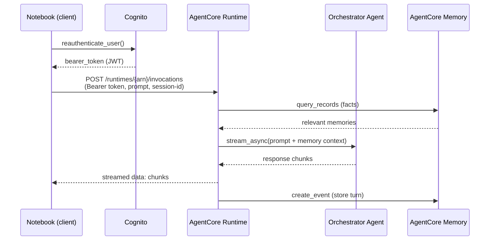
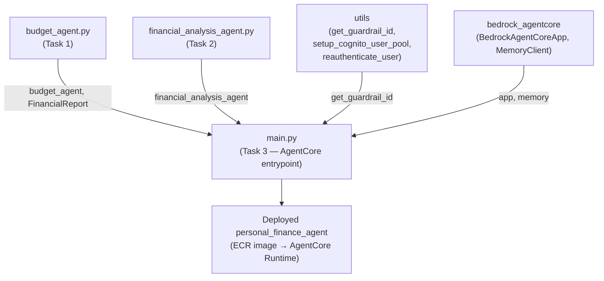

# Task 3: Deploy Agents on Amazon Bedrock AgentCore

This document explains how the agents and infrastructure in `Task-3.ipynb` relate to
each other, using Mermaid diagrams.

Task 3 does **not** add new agents. It takes the exact multi-agent system from Task 2
(Orchestrator + Budget Agent + Financial Analysis Agent) and wraps it in a production
**AgentCore Runtime** deployment, adding four infrastructure concerns around it:

- **Runtime hosting** — the agents run as a serverless container, not in a notebook.
- **Authentication** — Amazon Cognito issues JWT tokens for calling the endpoint.
- **Memory** — AgentCore Memory persists facts, preferences, and summaries across sessions.
- **Guardrail + Observability** — safety and tracing wired into the deployed agent.

So the "relationships" here are two layers: the **agent graph** (unchanged from Task 2)
and the **deployment stack** that hosts and secures it.

## 1. Deployment Architecture (Build → Deploy → Invoke)

The notebook packages `main.py` into a container, pushes it to ECR, creates the
AgentCore Runtime, and then invokes it over HTTPS with a Cognito token.

## 2. The Hosted Agent Graph (unchanged from Task 2)

Inside the running container, the agent structure is identical to Task 2: the
Orchestrator wraps both specialists as tools. AgentCore wraps the Orchestrator in an
HTTP app.

The `@app.entrypoint` function `invoke` is the bridge: AgentCore delivers each request
to it, and it streams the Orchestrator's response back chunk by chunk.

## 3. Request Lifecycle with Memory

Each invocation retrieves relevant memories *before* running the Orchestrator and
stores the conversation *after*. This is what gives the deployed agent cross-session
personalization that the local Task 2 version lacked.

## 4. AgentCore Memory Strategies

The memory resource is configured with three strategies, each writing to its own
namespace. These feed the context-retrieval step in diagram 3.

## 5. Invocation Path (Client → Deployed Agent)

How the notebook actually calls the deployed agent in Task 3.4: authenticate with
Cognito, then POST a streaming request to the AgentCore invocations endpoint.

## 6. Module / Import Relationships

`main.py` is rewritten in Task 3 (via `%%writefile`) to be AgentCore-compatible, but it
still imports the same specialist agents produced in Tasks 1 and 2.

## Summary

| Layer | Component | Role |
|-------|-----------|------|
| Entry | `BedrockAgentCoreApp` + `@app.entrypoint invoke` | HTTP server (:8080), `/invocations` + `/ping`, streams responses |
| Agents | Orchestrator → Budget Agent + Financial Analysis Agent | Same Task 2 "agents as tools" graph |
| Memory | AgentCore Memory (semantic / preference / summary) | Cross-session personalization via query + store |
| Auth | Amazon Cognito (JWT) | Authorizes callers to the runtime endpoint |
| Infra | ECR + AgentCore Runtime | Container registry + serverless hosting (ARM64/Graviton) |
| Safety | Bedrock guardrail + Observability | Content filtering and execution tracing |

The defining pattern of Task 3 is **productionizing an existing agent graph**: the
agents themselves are unchanged from Task 2, but they are now hosted in a managed
runtime, authenticated via Cognito, made stateful with AgentCore Memory, and exposed
through a streaming HTTP endpoint.
