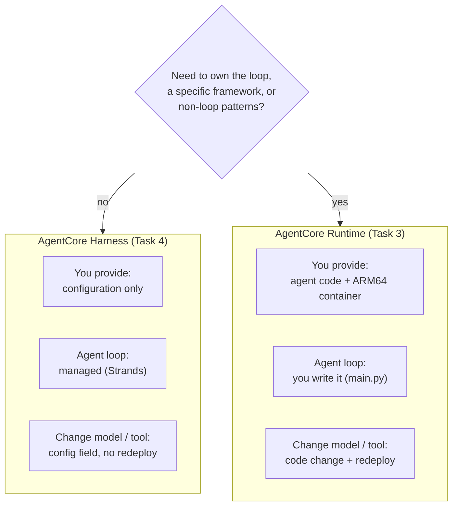
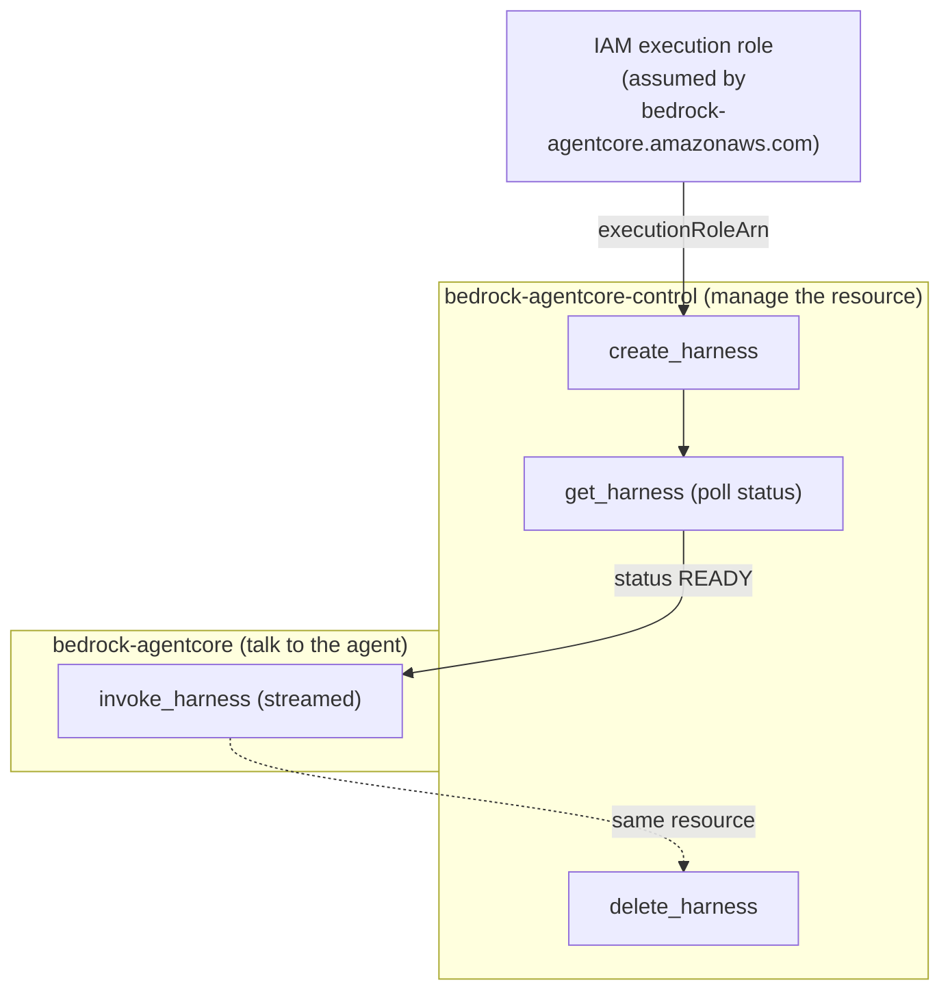
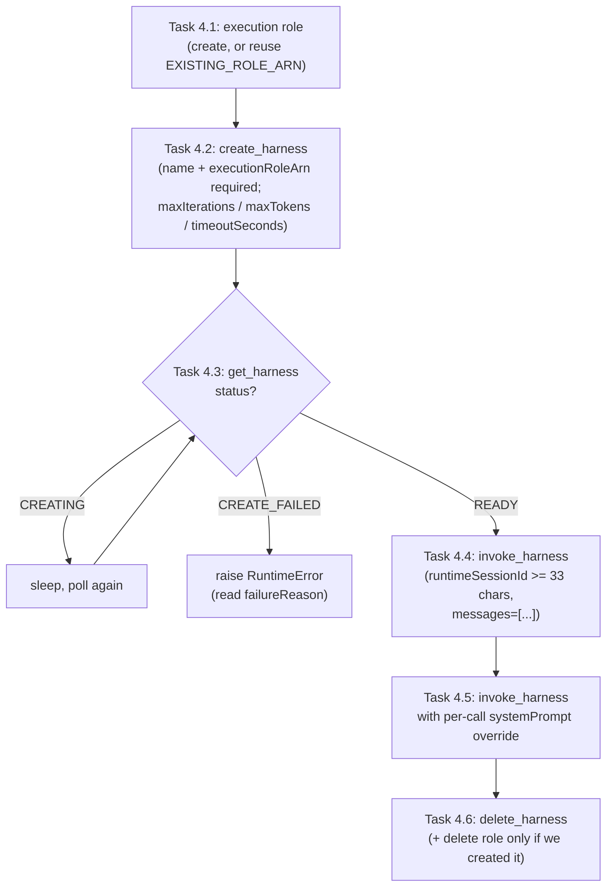
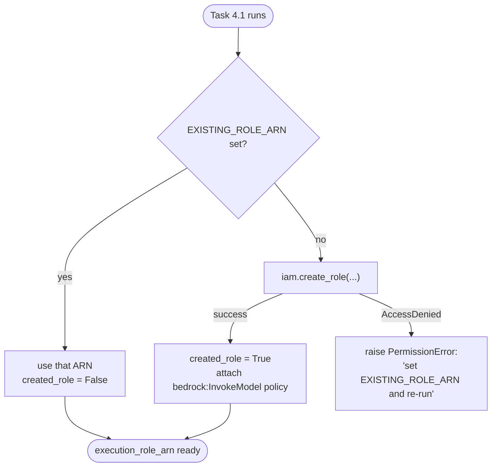
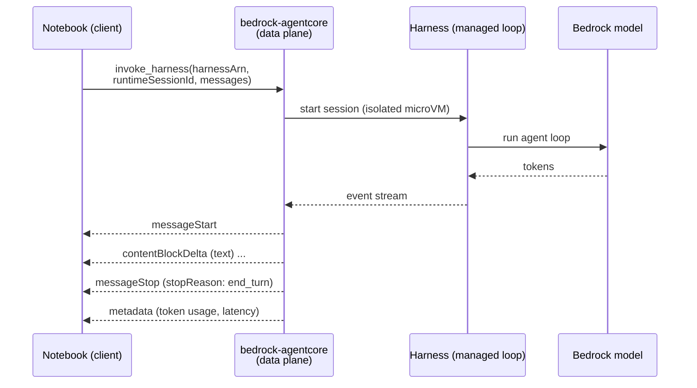
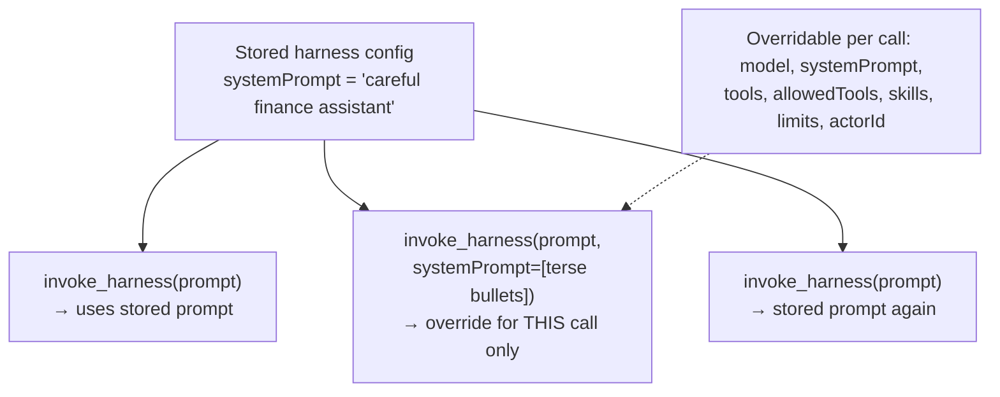

# Task 4: Run Agents with Amazon Bedrock AgentCore Harness

This document explains how the pieces in `Task-4.ipynb` relate to each other, using
Mermaid diagrams — the same companion-doc style as `Task-3.md`.

Task 4 does **not** add new agents or new agent code. Where Task 3 deployed a
multi-agent system to **AgentCore Runtime** by writing an orchestration loop in
`main.py`, packaging it into a container, and hosting it, Task 4 reaches the same
outcome — a running, invokable agent — from the opposite direction:

- **No loop code** — the reasoning → tool-call → result → response loop is managed by
  AgentCore (powered by Strands Agents).
- **No container** — nothing is built or pushed to ECR.
- **Configuration, not deployment** — the agent is *declared* (model, system prompt,
  limits) and changed with a single API field, not a code change and redeploy.

So the "relationships" here are two layers: the **control-plane resource lifecycle**
(create → wait → delete) and the **data-plane invocation** (streamed events). They live
on two different boto3 clients.

## 1. Harness vs. Runtime (the Task 3 contrast)

Both run on the same underlying AgentCore Runtime infrastructure, but divide the work
differently. Task 3 is the right column; Task 4 is the left.

Rule of thumb: **start with Harness; drop down to Runtime only when configuration is
not enough.**

## 2. The Two Clients (Control Plane vs. Data Plane)

Every operation in the notebook goes through one of two boto3 clients. Keeping them
straight is the key to reading the code.

Note the response shape: `create_harness` and `get_harness` both nest everything under
a top-level `harness` key — the notebook reads `response["harness"]["harnessId"]`,
`["arn"]`, and `["status"]`, **not** top-level fields.

## 3. The Three-Stage Lifecycle (Create → Wait → Invoke)

This is the defining pattern of the task, and the most common place to go wrong:
**creation alone does not yield a callable agent.** You must wait for `READY` before
invoking.

## 4. The Execution Role and Its Fallback (Task 4.1)

A harness assumes an IAM role. The trust policy is scoped with confused-deputy
conditions so only *this account's* harnesses can assume it. Because restricted lab
accounts often cannot create roles, the cell has a three-way branch.

`created_role` is the important flag: the cleanup cell (Task 4.6) deletes the role
**only when the notebook created it**, so a user-supplied `EXISTING_ROLE_ARN` is never
removed.

## 5. Invocation and the Streaming Event Format (Task 4.4)

`invoke_harness` returns an **event stream**, not a single string. The notebook's
`invoke_and_stream` helper iterates `response["stream"]` and prints text deltas as they
arrive — the same incremental experience as the console playground.

Key points the helper relies on:

- **`runtimeSessionId` ≥ 33 chars** — a `uuid4()` (36 chars with hyphens) satisfies it.
  Reusing the same id continues the conversation in the same environment.
- **`contentBlockDelta`** carries incremental `text` (also tool-use / tool-result /
  reasoning in richer configs).
- **`messageStop.stopReason`** reports *why* a message ended: `end_turn`, `tool_use`,
  `max_iterations_exceeded`, `timeout_exceeded`, `max_tokens`, etc.

## 6. Per-Invocation Overrides (Task 4.5)

The feature that makes a harness convenient for experimentation: a single call can
override the stored configuration **without redeploying**. The notebook overrides
`systemPrompt` for one call; the harness resource is unchanged.

> **Trust boundary:** overrides are caller-supplied. If a harness is exposed to
> untrusted users, strip or allowlist override fields (especially `model` and `skills`)
> in the application layer before calling `invoke_harness`.

## Summary

| Layer | Component | Role |
|-------|-----------|------|
| Auth / IAM | Execution role (`AgentCoreHarnessLabRole` or `EXISTING_ROLE_ARN`) | Role the harness assumes; confused-deputy-scoped trust |
| Control plane | `bedrock-agentcore-control`: `create_harness` / `get_harness` / `delete_harness` | Manage the harness resource and poll for `READY` |
| Agent loop | Managed Strands loop (no `main.py`, no container) | Reasoning → tool-call → result → response, run by AgentCore |
| Data plane | `bedrock-agentcore`: `invoke_harness` | Invoke the agent; returns a stream of typed events |
| Config | `systemPrompt`, `maxIterations`, `maxTokens`, `timeoutSeconds` | Declared behavior and execution-limit guardrails |
| Flexibility | Per-invocation overrides | Change model/prompt/limits for one call, no redeploy |

The defining pattern of Task 4 is **config-over-code**: where Task 3 productionized an
agent graph you wrote, Task 4 produces a running agent from declaration alone. The three
stages — **create → wait for `READY` → invoke (streamed)** — and the clean split between
the control-plane and data-plane clients are the whole mental model.

> **Note:** AgentCore Harness became generally available in June 2026, after the earlier
> tasks in this lab were authored, so Task 4 is a standalone addition rather than a
> continuation of the Task 1–3 finance-agent build.
